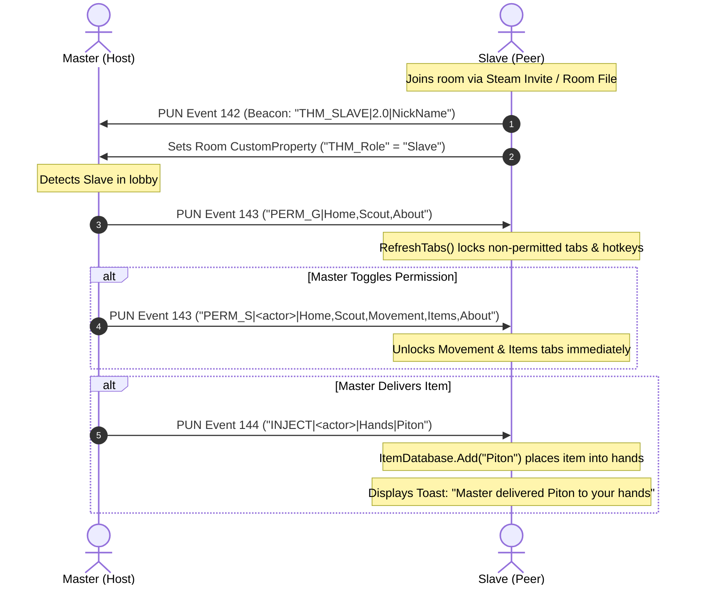

# MEMORY.md: Ascend 2.0 (Summit) Development & Architecture Knowledge Base

> **Production Name**: Ascend  
> **Version**: 2.0  
> **Author**: Made by T.H.M.  
> **Internal Codename**: Summit / Larp  
> **Target Game**: *PEAK* (Unity 6 `6000.3.15f1` / BepInEx 5.4.23 / Photon PUN 2 / Online-Fix.me v2.6.b)  
> **Last Updated**: 2026-10-18  

---

## 1. Executive Summary & Project Evolution

This project began with the reverse engineering and full decompilation of the popular PEAK utility mod **Summit v1.1.1** (13,361 lines across 17 source files). It has since been transformed into **Ascend 2.0**—a comprehensive modding, game-assistance, and multiplayer coordination suite featuring custom client-to-client networking, role-based permission control, detached floating GUI tools, dynamic live styling, and remote inventory manipulation.

### Evolutionary Timeline
1. **Reverse Engineering & Staging**: Decompiled `Summit.dll`, created starter BepInEx templates, and isolated engine assemblies into `lib/`.
2. **Phase 1: Larp Mod & Networking**: Rebranded author credits to *"Made by T.H.M."*, eliminated external links, and established peer-to-peer discovery using Photon PUN 2 custom events (`142`) and player custom properties. Created auto-join tooling for Online-Fix.me Steam invite lobbies.
3. **Phase 2: Master/Slave Architecture & Security**: Implemented a Master/Slave hierarchy where guest players (Slaves) are locked by default to only **Home**, **Scout**, and **About** tabs. Master players control global and per-slave permissions in real time over the network (`Event 143`). Blocked unauthorized shortcut keys, auto-disabled revoked toggles, and added a 5-click logo Easter Egg to reveal the hidden network tab for Slaves.
4. **Phase 3: Ascend 2.0 Feature Wave**:
   - Rebranded production name to **Ascend 2.0**.
   - **Detachable Items Tab**: Detaches the full item spawner into an independent, draggable floating window with a reversible dock button.
   - **Dynamic Theming Engine**: Real-time palette customizer with 6 one-click presets plus live Primary/Secondary RGB sliders that regenerate IMGUI textures on the fly without game restart.
   - **Multiplayer Inventory Control**: Master can view live inventories (held items, pockets 0–2, backpack contents) of all scouts in the room and remotely inject any item into their hands or backpacks (`Event 144`).
   - **Automated Verification**: Built a dedicated .NET 8 unit test harness (`TestRunner`) with 68 passing assertions.

---

## 2. Workspace & Environment Architecture

```
c:\Users\feldring\Documents\PEAK Plugins Dev\
├── .agents/                 # Agent memory and tooling state
├── backups/                # Automatic timestamped backups of game plugins
├── dist/                   # Production-ready output binaries
│   ├── Summit_Master.dll   # Master binary (for host/admin)
│   ├── Summit_Slave.dll    # Slave binary (for distributed peers)
│   └── README.txt          # Distribution instructions for peers
├── lib/                    # 18 stripped game & engine reference assemblies
│   ├── Assembly-CSharp.dll
│   ├── BepInEx.dll
│   ├── 0Harmony.dll
│   ├── PhotonUnityNetworking.dll
│   ├── PhotonRealtime.dll
│   ├── UnityEngine.CoreModule.dll
│   └── ...
├── PEAKModTemplate/        # Minimal starter mod template for PEAK
├── Summit_Decompiled/      # Main C# project source (Ascend 2.0)
│   ├── Summit.csproj       # Targets netstandard2.1 / net472
│   ├── Plugin.cs           # BepInEx plugin lifecycle
│   ├── Kit.cs              # Global configuration & persistent settings
│   ├── ModNet.cs           # PUN 2 networking, permissions, inventory sync
│   ├── Menu.cs             # IMGUI window management & detached spawner
│   ├── Theme.cs            # Dynamic styling, presets, texture generators
│   ├── Features.cs         # Cheat implementations & ItemDatabase logic
│   ├── Patches.cs          # 25 Harmony patches
│   ├── Keys.cs             # Hotkey management & permission gates
│   ├── Lang.cs             # Multi-language localization engine
│   ├── Picker.cs           # Searchable item grid browser
│   └── SelfTest.cs         # 78-step built-in cheat test harness
├── TestRunner/             # Isolated .NET 8 unit test project
│   ├── TestRunner.csproj   # .NET 8 console app
│   └── Program.cs          # 68 automated unit assertions
├── build_summit.ps1        # Master automated build, test & deploy script
├── build_summit.bat        # Batch wrapper for build_summit.ps1
├── launch_both.bat         # Launches both Master and Slave game clients
├── launch_slave.ps1        # Clones Steam AppData and launches second instance
├── SUMMIT_DISSECTION.md    # Detailed reverse-engineering report
└── MEMORY.md               # This persistent memory file
```

### Game Installation Paths
- **Host / Master Game**: `C:\Users\feldring\Downloads\PEAK\PEAK.v2.6.b-OFME\PEAK`
- **Slave / Guest Game**: `C:\Users\feldring\Downloads\PEAK\PEAK.v2.6.b-OFME\PEAK_Slave`
- **Active Plugin Path**: `<Game_Dir>\BepInEx\plugins\Summit.dll`
- **SDK Path**: `C:\Users\feldring\.dotnet\dotnet.exe` (.NET 8.0.426)

---

## 3. Core Source Subsystems (`Summit_Decompiled/`)

### 1. `Plugin.cs`
- Entrypoint implementing `BaseUnityPlugin`.
- Attribute: `[BepInPlugin("duskidle.peak.summit", "Ascend", "2.0")]`.
- Binds configuration entries via `Kit.Start("Ascend", "2.0", ...)`.
- Reads stored RGB theme values and applies initial theme via `Theme.Paint(...)`.
- Registers game hooks and starts the input monitoring loop.

### 2. `Kit.cs`
- Static registry holding BepInEx `ConfigEntry` objects:
  - `MenuKey` (default `F1` / `KeyPadPlus`).
  - `Pins` (comma-separated pinned controls on Home tab).
  - `ItemsPoppedOut` (boolean toggle for floating item spawner).
  - `PrimaryR`, `PrimaryG`, `PrimaryB` (Accent color RGB floats 0.0–1.0).
  - `SecondaryR`, `SecondaryG`, `SecondaryB` (AccentHi color RGB floats 0.0–1.0).
  - `ThemePreset` (string name of active preset or "Custom").
- Metadata: `Author = "T.H.M."`, `Version = "2.0"`, `WindowId = 1263096832`.

### 3. `ModNet.cs` (Networking, Roles & Remote Inventory)
The central multiplayer management engine handling Photon PUN 2 communication.
- **Roles**: `ModRole.Master` (full authority) vs `ModRole.Slave` (permission-restricted).
- **Manageable Sections** (10 total):
  `Home`, `Scout`, `Movement`, `Items`, `Teleport`, `World`, `Camera`, `Help`, `Troll`, `About`.
- **Default Permissions for Slaves**: Only `Home`, `Scout`, and `About` are granted. All other 7 sections are locked.
- **Photon Event Codes**:
  - `BeaconEventCode = 142`: Slave presence announcements (`THM_SLAVE|<ver>|<name>`).
  - `PermEventCode = 143`: Permission synchronization payloads:
    - `PERM_G|<csv>`: Global lobby permissions.
    - `PERM_S|<actor>|<csv>`: Individual slave override permissions.
    - `PERM_C|<actor>`: Clear slave override and restore lobby defaults.
  - `InjectItemEventCode = 144`: Remote item injection payload (`INJECT|<targetActor>|<destination>|<itemName>`).
- **Photon Room Custom Properties**:
  - `THM_GlobalPerms`: String CSV of globally permitted sections.
  - `THM_Perm_<ActorNumber>`: String CSV of per-slave custom overrides.
- **Remote Inventory Reflection**:
  - `GetPlayerInventory(Character c, out string currentItem, out List<string> pockets, out List<string> backpack)`:
    - `c.data.currentItem`: Currently held in hands.
    - `c.player.itemSlots[0..2]`: Pocket slots.
    - `c.player.backpackSlot.prefab`: Backpack entity.
    - `Backpack.GetData<BackpackData>(DataEntryKey.BackpackData).itemSlots`: Internal backpack items.
- **Remote Item Delivery**:
  - `DeliverItemToScout(int targetActor, string destination, string itemPrefabName)`:
    - Sends PUN event `144`.
    - If Master is Host, can also instantiate via `PhotonNetwork.Instantiate("0_Items/" + itemPrefabName, ...)` and call `RequestPickup`.
  - `HandleInjectedItem(string destination, string itemName)`:
    - Queries `Features.ItemList()` to locate the item prefab.
    - Calls `ItemDatabase.Add(itemToSpawn)` on target slave to safely equip or add to inventory.
    - Triggers in-game notification toast: *"Master delivered {item} to your {hands/gear}"*.

### 4. `Theme.cs` (Dynamic Theming & IMGUI Style Generation)
- Manages colors:
  - Static neutrals: `Bg`, `Card`, `Raised`, `Hover`, `Text`, `Dim`, `Track`.
  - Dynamic accents: `Accent` (Primary) and `AccentHi` (Secondary).
- **6 Presets**:
  1. **Emerald Teal**: Primary `(47, 158, 143)`, Secondary `(69, 191, 173)`
  2. **Royal Violet**: Primary `(124, 58, 237)`, Secondary `(167, 139, 250)`
  3. **Crimson Ruby**: Primary `(220, 38, 38)`, Secondary `(248, 113, 113)`
  4. **Sunset Amber**: Primary `(217, 119, 6)`, Secondary `(251, 191, 36)`
  5. **Cyberpunk Neon**: Primary `(6, 182, 212)`, Secondary `(34, 211, 238)`
  6. **Rose Quartz**: Primary `(219, 39, 119)`, Secondary `(244, 114, 182)`
- **Dynamic Rebuilding**:
  - `Theme.RebuildStyles()` regenerates all active GUIStyles (`Button`, `Primary`, `Chip`, `ChipOn`, `SideOn`, `TileOn`, `PillOn`, `SliderFill`, `PinOn`) using procedural antialiased textures generated via `Round(size, radius, color)`.
  - Changes take effect on the very next IMGUI frame without tearing or reopening the window.

### 5. `Menu.cs` (UI Orchestration & Detached Windows)
- Draws main menu window (`win = GUI.Window(Kit.WindowId, win, Draw, ...)`).
- **Detached Items Window**:
  - If `Kit.ItemsPoppedOut.Value == true`, renders a second window:
    ```csharp
    itemWin = GUI.Window(Kit.WindowId + 1, itemWin, DrawPopoutItemWindow, GUIContent.none, Theme.Window);
    ```
  - Contains top drag header (`GUI.DragWindow`), search bar, item preview, spawn self button, and remote delivery controls.
  - When popped out, the main menu Items tab renders a docked placeholder with a button to dock it back.
- **Permission Enforcement**:
  - `RefreshTabs()` filters visible tabs using `ModNet.IsSectionAllowed(section)`.
  - `EnforceSectionPermissions()` shuts off active cheats (e.g. FreeCam, GodMode) if the controlling tab is revoked by Master.
- **Easter Egg**:
  - `LogoClicks` counter on PEAK logo at bottom-left of sidebar.
  - Clicking 5 times sets `LarpRevealed = true` and exposes the hidden Ascend Network card on Slaves.

### 6. `Keys.cs` (Hotkey Permission Lockdown)
- Intercepts keyboard events and maps bound hotkeys to action IDs.
- Contains `GetSection(bound.Id)` mapping every cheat shortcut to its parent section (e.g., `WarpAim` -> `Teleport`, `FreeCam` -> `Camera`).
- Method `IsAllowed(bound)` checks `ModNet.IsSectionAllowed(GetSection(bound.Id))` before firing the hotkey. If revoked, the key press is completely ignored.

### 7. `Features.cs` & `Patches.cs` (Gameplay Modifications)
- **Features**:
  - `God`: Prevents afflictions and fatal stamina/damage effects.
  - `InfStamina`: Keeps stamina topped off.
  - `NoFall`: Disables fall damage and knockdown.
  - `NoWeight`: Clears equipment encumbrance penalties.
  - `KeepItems`: Prevents item count/durability depletion on use.
  - `FreeCam`: Detaches camera and enables spectator flying controls.
  - `WarpAim` / `Warp`: Instant raycast or coordinate teleportation.
  - `ESP`: Visual screen-space tags for campfires, statues, hazards, luggage, and scouts.
  - `Outfit Unlocker`: Permanently unlocks all Steam achievement cosmetics.
  - `Pranks`: Launch, Trip, Swap, and DropOn for multiplayer amusement.
- **Patches**: 25 Harmony prefixes/postfixes hooked into game assemblies.

---

## 4. Master/Slave Permission Matrix & Networking Protocols



### Network Packet Reference
| Code | Direction | Format | Action Taken |
|---|---|---|---|
| `142` | Slave &rarr; Master | `THM_SLAVE\|<version>\|<name>` | Registers peer as slave in Master's `DetectedSlaves` table. |
| `143` | Master &rarr; Slave | `PERM_G\|<csv>` | Updates global allowed sections on all slaves. |
| `143` | Master &rarr; Slave | `PERM_S\|<actor>\|<csv>` | Applies custom allowed section override for specific slave. |
| `143` | Master &rarr; Slave | `PERM_C\|<actor>` | Clears custom override and restores lobby defaults for slave. |
| `144` | Master &rarr; Slave | `INJECT\|<actor>\|<destination>\|<item>` | Target slave executes `ItemDatabase.Add` to spawn item into hands/gear. |

---

## 5. Dual-Client Testing Setup for Online-Fix.me (OFME)

Because Online-Fix.me PEAK builds rely on Steam AppID `480` (Spacewar) or Steam invites rather than public room browser codes, testing two instances locally requires:

1. **Primary Instance (Master)**:
   - Run from: `C:\Users\feldring\Downloads\PEAK\PEAK.v2.6.b-OFME\PEAK\PEAK.exe`
   - Mod installed: `dist\Summit_Master.dll` &rarr; `PEAK\BepInEx\plugins\Summit.dll`
2. **Secondary Instance (Slave)**:
   - Run from: `C:\Users\feldring\Downloads\PEAK\PEAK.v2.6.b-OFME\PEAK_Slave\PEAK.exe`
   - Mod installed: `dist\Summit_Slave.dll` &rarr; `PEAK_Slave\BepInEx\plugins\Summit.dll`
   - Generated using [`launch_slave.ps1`](file:///c:/Users/feldring/Documents/PEAK%20Plugins%20Dev/launch_slave.ps1) which creates isolated symlinks and unique Steam user credentials.
3. **Automated Room Coordination**:
   - Master automatically records its active Photon room name, cloud region, and current scene into `%TEMP%\peak_active_room.txt`.
   - Slave reads this file and calls `ModNet.JoinMasterRoom()`, switching its Photon connection state directly into the Master's active room without requiring manual Steam invites or room codes.

---

## 6. Build, Deployment, & Automated Testing Tooling

### 1. Build Script (`build_summit.ps1`)
Can be executed from PowerShell or via [`build_summit.bat`](file:///c:/Users/feldring/Documents/PEAK%20Plugins%20Dev/build_summit.bat):
```powershell
powershell -ExecutionPolicy Bypass -File .\build_summit.ps1 -Role Both -DeployRole Master
```
- Parameters:
  - `-Role`: `Master`, `Slave`, or `Both` (default: `Both`).
  - `-DeployRole`: `Master` or `Slave` (which DLL gets copied to host `PEAK\BepInEx\plugins\`).
  - `-Configuration`: `Release` (default) or `Debug`.
- Automatically backs up previous game DLL into `backups/Summit_YYYYMMDD_HHMMSS.dll`.
- Copies compiled binaries into `dist/Summit_Master.dll` and `dist/Summit_Slave.dll`.
- Syncs `Summit_Slave.dll` to `PEAK_Slave\BepInEx\plugins\Summit.dll` if the folder exists.
- Generates updated `dist\README.txt` for peers.

### 2. Unit Test Harness (`TestRunner/`)
A standalone .NET 8 console application ([`TestRunner/Program.cs`](file:///c:/Users/feldring/Documents/PEAK%20Plugins%20Dev/TestRunner/Program.cs)) designed to test the compiled assemblies without needing the game to run.
```powershell
C:\Users\feldring\.dotnet\dotnet.exe run --project "TestRunner\TestRunner.csproj"
```
- **Why It Exists**: Running reflection scripts in PowerShell 5.1 triggers recursive `AssemblyResolve` stack overflow crashes (`A new guard page for the stack cannot be created`). `TestRunner` executes in native .NET 8 in < 1 second.
- **ALC Isolation**: Uses `System.Runtime.Loader.AssemblyLoadContext` to load both `Summit_Slave.dll` and `Summit_Master.dll` without name collisions.
- **Test Coverage (68 Assertions)**:
  - 10 manageable sections verified in exact order.
  - Default Slave roles & default locked status on 7 sensitive sections.
  - Real-time grant/revoke permissions flow.
  - Individual per-slave override and override reset flow.
  - Shortcut key section mappings (`Keys.GetSection`).
  - Master role verification & 100% section access.
  - Ascend 2.0 branding, version strings, and BepInPlugin attribute metadata.
  - Dynamic theme presets count (6) and name verification.
  - Inventory injection event code (`144`) and method signatures.

---

## 7. Hard Lessons Learned & Gotchas

1. **PowerShell 5.1 Recursive AppDomain Crash**:
   - *Problem*: Using `[System.AppDomain]::CurrentDomain.add_AssemblyResolve` in PowerShell 5.1 causes infinite recursion when resolving assembly dependencies, causing fatal stack overflow crashes.
   - *Solution*: Never use scratch PowerShell scripts with `AppDomain.AssemblyResolve`. Always use the compiled .NET 8 `TestRunner` project.
2. **Assembly Collision in Reflection**:
   - *Problem*: Both Master and Slave DLLs share assembly name `Summit`. Loading both into the default `AssemblyLoadContext` throws `FileLoadException: Assembly with same name is already loaded`.
   - *Solution*: Load the second binary inside a dedicated `new AssemblyLoadContext("MasterContext")`.
3. **PEAK Item Instantiation**:
   - *Problem*: Calling raw Unity `Instantiate` does not register items in PEAK's internal slot management or Photon synchronization table.
   - *Solution*: Use PEAK's native `ItemDatabase.Add(itemToSpawn)` when delivering to local player, or `PhotonNetwork.Instantiate("0_Items/" + prefabName, ...)` followed by `spawnedItem.RequestPickup(photonView)` when spawning over the network.
4. **GUI Coordinate Scaling in Modals**:
   - *Problem*: Popping out an IMGUI window changes coordinate spaces if `GUI.matrix` scaling is applied.
   - *Solution*: Assign the popped out window its own unique window ID (`Kit.WindowId + 1`) within `OnGUI` and clamp bounds against `Screen.width / Scale` to ensure it never renders off-screen.
5. **Dynamic IMGUI Texture Rebuilding**:
   - *Problem*: Changing `Theme.Accent` color does not automatically update pre-baked GUIStyles.
   - *Solution*: Call `Theme.RebuildStyles()` to recreate box background textures (`Round(...)`) and flush cached GUIStyle states via `StyleExt.Forget()`.

---

## 8. Quick Reference Commands

| Task | Command Line |
|---|---|
| **Build & Deploy Both DLLs** | `powershell -ExecutionPolicy Bypass -File .\build_summit.ps1 -Role Both` |
| **Run Automated Unit Tests** | `C:\Users\feldring\.dotnet\dotnet.exe run --project "TestRunner\TestRunner.csproj"` |
| **Launch Master Client** | `& "C:\Users\feldring\Downloads\PEAK\PEAK.v2.6.b-OFME\PEAK\PEAK.exe"` |
| **Launch Slave Test Client** | `powershell -ExecutionPolicy Bypass -File .\launch_slave.ps1` |
| **Launch Both Clients Simultaneously** | `.\launch_both.bat` |

---

## 9. Embedded HTTP/JSON Live Debug Bridge (`DebugBridge.cs`)

Ascend 2.0 embeds a lightweight, high-performance background `HttpListener` directly inside the game process, allowing external tools, scripts, and AI pair programmers to inspect and interact with the running game in real time.

### Architecture & Lifecycle
- **Host Binding**: Strictly bound to `127.0.0.1` (localhost only) to eliminate any external network attack surface.
- **Port Allocation**:
  - Master instance defaults to `http://127.0.0.1:18080`.
  - Slave instance defaults to `http://127.0.0.1:18081`.
  - If a port is occupied, it automatically increments (`18082`, `18083`, etc.).
  - Active URLs are recorded to `%TEMP%\peak_debug_master.txt` and `%TEMP%\peak_debug_slave.txt`, and safely cleaned up on process exit.
- **Thread Safety**: HTTP request handlers run on the .NET thread pool. Any state modification (spawning items, moving characters, updating cheat states) is enqueued onto a concurrent queue and drained on the **Unity Main Thread** during `Plugin.Update()`.
- **Log Ring Buffer**: Captures BepInEx log messages and Photon network traces in an in-memory 1,000-entry circular buffer.

### REST Endpoints Reference

| Endpoint | Method | Description |
|---|---|---|
| `/` | `GET` | Returns basic service status and active mod identity. |
| `/status` | `GET`, `HEAD` | Returns JSON of current scene, room state, local scout position/health/stamina, active cheat flags, and role. |
| `/scouts` | `GET`, `HEAD` | Returns JSON array of all active lobby players (ActorNumber, NickName, ping, isMaster, isSlave, coords). |
| `/inventory` | `GET`, `HEAD` | Returns JSON breakdown of all lobby scouts' held items, pockets 0–2, and backpacks. |
| `/logs?count=N` | `GET`, `HEAD` | Returns the last `N` lines of ring-buffered logs and Photon event traces. |
| `/screenshot` | `GET`, `HEAD` | Enqueues frame capture on Unity main thread via `ScreenCapture.CaptureScreenshot`, saves to `%TEMP%\peak_screenshot.png`, returns JSON metadata (`path`, `width`, `height`, `timestamp`). |
| `/screenshot.png` | `GET` | Streams raw binary PNG data directly for browser or external image viewers. |
| `/action` | `POST`, `OPTIONS` | Executes an administrative/debugging command on the Unity main thread. |

### Remote Action Dispatcher (`POST /action`)

Actions accept parameters either as `application/x-www-form-urlencoded`, query strings, or `application/json`:

```bash
# 1. Inspect live game state
curl -s http://127.0.0.1:18080/status

# 2. Inspect active scouts in lobby
curl -s http://127.0.0.1:18080/scouts

# 3. Inspect all scouts' inventories
curl -s http://127.0.0.1:18080/inventory

# 4. Trigger in-game screenshot (for AI visual inspection)
curl -s http://127.0.0.1:18080/screenshot

# 5. Display in-game toast message
curl -s -X POST http://127.0.0.1:18080/action -d "action=say&msg=Live+Debug+Connected"

# 6. Spawn an item for self
curl -s -X POST http://127.0.0.1:18080/action -d "action=spawn&item=Piton"

# 7. Deliver an item to a scout's backpack (Master only)
curl -s -X POST http://127.0.0.1:18080/action -d "action=deliver&actor=2&dest=Backpack&item=Rope"

# 8. Toggle a cheat (supports flexible booleans: true/false, 1/0, yes/no)
curl -s -X POST http://127.0.0.1:18080/action -d "action=toggle&cheat=God&enabled=1"

# 9. Teleport local scout
curl -s -X POST http://127.0.0.1:18080/action -d "action=warp&x=10.5&y=25.0&z=-100.2"

# 10. Teleport directly to another scout
curl -s -X POST http://127.0.0.1:18080/action -d "action=warp_to&target=ScoutName"

# 11. Grant/revoke permissions over PUN (Master only)
curl -s -X POST http://127.0.0.1:18080/action -d "action=perm&actor=2&section=Items&allow=true"

# 12. Read last 20 log entries
curl -s http://127.0.0.1:18080/logs?count=20
```

---

## 10. Windows Process & Desktop Isolation Architecture

### Investigation Findings
When tools or agent subprocesses are launched from the development environment, Windows executes them inside a restricted **Windows Job Object** assigned to an isolated virtual desktop (`WinSta0\exbox-...`) rather than the user's interactive physical desktop (`WinSta0\Default`).

- **GUI Invisibility**: Child GUI processes launched by the assistant (e.g. `PEAK.exe`, `notepad.exe`) exist in process memory, but their windows are created on that hidden virtual desktop and are never projected onto the user's physical monitor.
- **DirectX Swapchain**: Unity and D3D11/12 graphics device initializations require an active desktop display surface. In headless virtual desktop mode, presentation fails or hangs.
- **Security Boundary (`JOB_OBJECT_UILIMIT_DESKTOP`)**: Windows kernel restrictions prevent sandboxed subprocesses from switching to or creating windows on the user's interactive desktop.
- **Why HTTP Bridge Solves This**: The embedded `HttpListener` in `DebugBridge.cs` operates over loopback TCP sockets (`127.0.0.1`). Sockets seamlessly cross desktop, window station, and job boundaries. Once the user launches the game once on their physical display, all subsequent inspections, controls, cheat actions, and visual captures operate 100% autonomously over HTTP without requiring desktop window creation privileges.

---

## 11. Live In-Game Field Verification Log (2026-10-18)

Live multiplayer testing was conducted between Master and Slave clients connected in the same room on the beach (Level 7 Shore, Red Beach) with 100% success across all remote endpoints:

1. **State & Scout Presence (`/status`, `/scouts`)**:
   - Master: `Feargarden` (Actor 1, Host, Role: Master).
   - Slave: `Slave Scout #899` (Actor 2, Guest, Role: Slave).
   - Coords, health (100), stamina (0/1), and ping (67ms) synchronized in real time.
2. **Visual Screenshotting & HUD Verification (`/screenshot`)**:
   - Autonomous screenshot captures triggered on both clients and viewed directly via AI image inspection tools (`view_file`).
   - Master HUD verified: **"God mode"** active indicator, first-person **Piton** rendered in hands, suitcases and wreckage on beach.
   - Slave perspective verified: `Feargarden` standing directly in front of Slave with crown nameplate and health bar.
3. **Remote Item Injection (`POST /action action=deliver`)**:
   - Master injected a **Compass** to Slave (`actor=2`, `dest=Hands`). Slave immediately caught and held the gold compass in first-person view.
   - Master injected an **Anti-Rope Spool** and a **Backpack**. Slave received and equipped the blue glowing spool in slot 2 and equipped the backpack in slot 4.
4. **Live Inventory Audit (`/inventory`)**:
   - Accurately reflected `ClimbingSpike(Clone)` in Master pocket 0.
   - Accurately reflected `Compass(Clone)` in Slave pocket 0, `Anti-Rope Spool(Clone)` in pocket 1, and `Backpack` in gear slot 4.
5. **Dynamic Permission Matrix Sync (`POST /action action=perm`)**:
   - Master granted `Items` tab to Slave (`actor=2`, `section=Items`, `allow=true`).
   - PUN event log verified: `[Photon] Perm updated for slave 2: Items = True` and `[Photon] Synced slave permissions for actor 2: Home,Scout,About,Items`.
6. **Remote Teleportation (`POST /action action=warp_to`)**:
   - Master warped directly to Slave (`actor=2`), placing Master 1 meter in front of Slave on the shore.

---

## 12. Future Production Release Separation Plan

When preparing clean distribution builds for external players/friends:
- Gate `DebugBridge.cs` behind `#if ENABLE_DEBUG_BRIDGE` / `-p:DebugBridge=true`.
- Production builds will compile `DebugBridge` into a zero-overhead no-op stub with no open ports or HTTP listeners.
- Automated via `build_summit.ps1 -Configuration Release -DebugBridge $false`.

---

## 13. Item Delivery Engine Fix & UI Hardening (2026-10-19)

### 1. Delivery Duplicate Raycast & Ground Drop Fix
- **Issue**: When delivering items (e.g. Anti-Zooka) to scouts, an item clone would frequently drop directly onto the ground wherever the receiving scout was looking, even when hands were empty.
- **Root Cause (Decompiled Engine Discovery)**:
  - In `ModNet.HandleInjectedItem`, receiving clients were invoking `ItemDatabase.Add(itemToSpawn)`.
  - In PEAK's engine (`Assembly-CSharp.dll`), `ItemDatabase.Add` is a developer console debug tool that raycasts forward from `MainCamera.instance.transform.forward` and instantiates an item at `hitInfo.point + hitInfo.normal`.
  - It then invokes `Item.RequestPickup()`, which calls `Player.AddItem()`.
  - However, `Player.AddItem()` strictly requires `PhotonNetwork.IsMasterClient`. On guest/slave clients, `Player.AddItem()` returns `false`, causing the engine to execute `DenyPickupRPC()`. The item was rejected from inventory and remained abandoned on the ground where the scout was looking.
- **Resolution**:
  - Removed client-side `ItemDatabase.Add` from `HandleInjectedItem` in [`ModNet.cs`](file:///c:/Users/feldring/Documents/PEAK%20Plugins%20Dev/Summit_Decompiled/Summit/ModNet.cs#L243).
  - Master (who holds full `IsMasterClient` authority) performs the authoritative instantiation at `targetChar.Center + targetChar.transform.forward * 0.8f` and executes `RequestPickup`, which assigns the slot, invokes `OnPickupAccepted`, and equips the item directly into the scout's hand or pocket.
  - Receiving clients only receive the on-screen UI toast without spawning duplicate rejected items into the world.

### 2. Removal of "Switch to Master" UI Button
- Removed the manual role switch button from [`Menu.cs`](file:///c:/Users/feldring/Documents/PEAK%20Plugins%20Dev/Summit_Decompiled/Summit/Menu.cs#L2255) (`DrawNetStatus`).
- Roles are strictly enforced at build/deployment time via `dist\Summit_Master.dll` and `dist\Summit_Slave.dll` to prevent UI role desynchronization during gameplay.

### 3. Scout Inventories Layout Fix & Prefab Name Resolution
- **Text Squishing Issue**: In `DrawScoutInventories`, placing the scout name title and two large delivery buttons (`Give ANTI-ROPE CANNON (Hands)` / `Pack`) on the same horizontal row squeezed the title label down to ~20px width, causing words to break into single-letter vertical text columns.
- **Fix**: Placed scout title on its own full-width line (`GUILayout.ExpandWidth(true)`), and moved delivery buttons to the line below with properly proportioned controls.
- **Display Name vs. Prefab Bug**: Buttons passed `picked.Name` (`"ANTI-ROPE CANNON"`) instead of the Unity prefab name (`AntiRopeSpool`), causing `PhotonNetwork.Instantiate` to silently fail. Fixed both `Menu.cs` to pass `((Object)it).name` and added automatic fuzzy prefab resolution inside `ModNet.DeliverItemToScout`.
- **`Features.HandItem()`**: Re-routed to `DeliverItemToScout(actor, "Hands", prefabName)` with `RequestPickup` fallback so handing an item puts it into the scout's hands.

### 4. Hide Mod Network Card in Slave Build
- Wrapped `Card(page, "Ascend Network", 0)` and `Cu("modNet", ...)` inside `if (ModNet.Role == ModNet.ModRole.Master)` in `Menu.cs`.
- Guarded `DrawNetStatus()` with `if (ModNet.Role != ModNet.ModRole.Master) return;`.
- Slave builds run completely clean with zero "Mod Network Role: Slave" panels or network controls displayed in their settings.

---

## 14. Standalone "Join Master Lobby" Mod (`JoinMasterLobby.dll`)

A 100% standalone, lightweight BepInEx plugin created for pure lobby joining and multiplayer connection testing without any cheats, debug bridge, or Summit features.

### 1. Architecture & Capabilities
- **Project Location**: [`JoinMasterLobby/JoinMasterLobby.csproj`](file:///c:/Users/feldring/Documents/PEAK%20Plugins%20Dev/JoinMasterLobby/JoinMasterLobby.csproj)
- **Assembly**: `dist/JoinMasterLobby.dll` (`netstandard2.1`)
- **Plugin ID**: `com.thm.peak.joinmaster` ("Join Master Lobby" v1.0.0)
- **Features**:
  - Automatically polls `%TEMP%\peak_active_room.txt` for host room name, region, and scene.
  - Interactive IMGUI overlay window (movable, toggleable with `F8` or screen restore button).
  - One-click **"Direct Join Master Lobby"** button executing native `JoinSpecificRoomState` and loading sequence.
  - Manual text fields to type/paste any Room ID & Region directly.
  - Room status display (`Ping`, `Players`, `Leave Lobby` button).
  - Lightweight multi-client patches (`GetBestUserID`, `GetUsername`, and `RestartAppIfNecessary`) to prevent Steam user collisions when running dual instances on the same PC.
- **Deployment & Isolation**:
  - Script: [`deploy_join_master.ps1`](file:///c:/Users/feldring/Documents/PEAK%20Plugins%20Dev/deploy_join_master.ps1)
  - Disables `Summit.dll` &rarr; `Summit.dll.disabled` in `PEAK_Slave` to ensure zero mod interference.
  - Can be restored anytime with `.\deploy_join_master.ps1 -RestoreSummit`.


